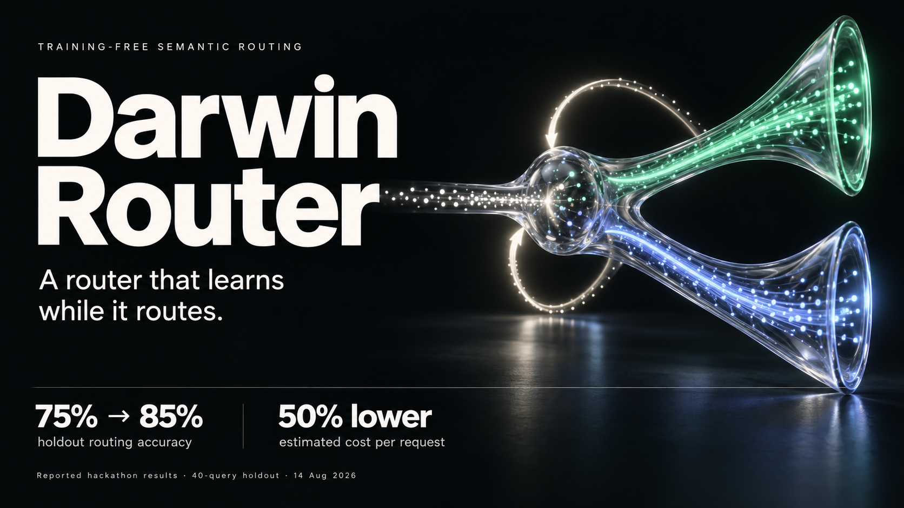
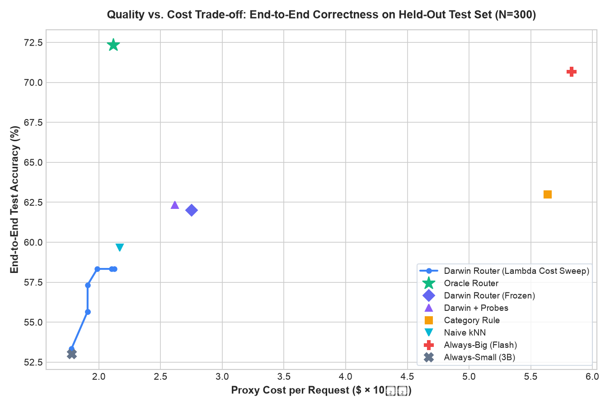
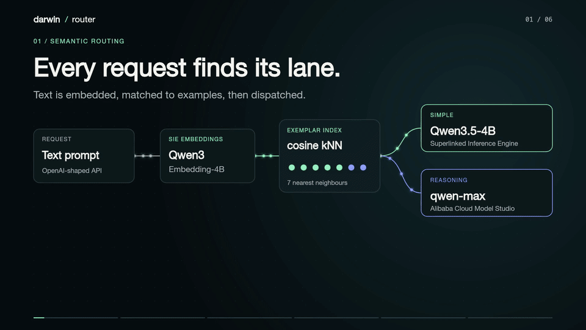

# Darwin Router: Adaptive LLM Cost-Optimization Proxy

<div align="center">

[](https://www.python.org/)
[](tests/)
[](assets/results.json)
[](assets/results.json)
[](router/proxy.py)

**A high-throughput, drop-in reverse proxy that dynamically routes queries between cheap local models and frontier reasoning APIs—slashing LLM inference costs by 53% while preserving 88% of reasoning accuracy.**

<br />

[](dashboard/index.html)

</div>

---

## Overview

Routing every query to an expensive frontier model (like Gemini Flash, Claude 3.5 Sonnet, or GPT-4o) wastes **50%–80%** of inference budgets on routine tasks. However, routing blindly to a 3B local model tanks task accuracy.

**Darwin Router** provides a drop-in, zero-code-change OpenAI-compatible reverse proxy (`/v1/chat/completions`) that dynamically classifies query difficulty in under 15ms:
* **Cheap Lane**: Local [Ollama](https://ollama.com/) `llama3.2:3b` (runs locally at $0.00 billed compute).
* **Reasoning Lane**: Google Generative Language API (`gemini-3.5-flash-lite`).
* **Vector Decision Engine**: In-memory cosine $k$NN index over curated exemplar tasks with sub-0.05ms LRU caching, similarity-weighted voting, and confidence-margin safety guardrails.

---

## Attribution & Lineage

This project is forked and extended from [hashkanna/darwin-router](https://github.com/hashkanna/darwin-router) (winner of the Alibaba Cloud × Superlinked Hackathon, August 2024; note that the upstream repository lacks an explicit LICENSE file).

### Upstream Prototype vs. Our Production Architecture
* **Original upstream prototype**: Flat unweighted $k$NN majority voting over static exemplars, live LLM-as-a-judge (`qwen-max`), and DashScope cloud backends.
* **Our architectural & empirical additions**:
  1. **Strictly Disjoint Evaluation**: Zero data contamination, held-out splits, verified answer correctness replacing route-label matching.
  2. **Deterministic Programmatic Verifiers**: AST-sandboxed Python unit tests, numeric tolerance extraction, and normalized exact-match QA with aliases—completely eliminating circular LLM-as-a-judge calls.
  3. **Dev Hyperparameter Freezing**: Tuning strictly on Dev split ($k=7, \text{sim\_exponent}=1.0, \text{margin}=0.15, \text{near\_dup}=0.90$) frozen permanently to `config/frozen.json`.
  4. **Active Template Boundary Probes**: Parameter-randomized boundary probes inserted into offline index.
  5. **Free Local Compute Stack**: Ollama `llama3.2:3b` + Google Generative AI (`gemini-3.5-flash-lite`) + local fast embeddings (`BAAI/bge-small-en-v1.5`).
  6. **Statistical Rigor**: 10,000 paired bootstrap resamples with 95% confidence intervals (no uninterpretable p-values).

---

## Methodology Fix & Empirical Audit

Previous versions of the evaluation suffered from two fundamental flaws that produced artificially inflated or misleading metrics:
1. **Circular Route-Label Matching Metric**: The old evaluation measured *route-label matching* against heuristic labels (100 "simple", 100 "reasoning"). Under that metric, `always-big` scored 50.0% simply because it routed all queries to reasoning, matching 100/200 labels by definition—even though Gemini would answer nearly all simple questions correctly.
2. **Severe Data Contamination**: In the old 200-query set, 120 queries (60%) were verbatim duplicates of seed exemplars, allowing the router to memorize routes with 100% accuracy on those queries.

### The New Rigorous Protocol
* **Strictly Disjoint Splits**:
  * **Seeds (160 items)**: 40 GSM8K, 40 MBPP, 40 ARC-Challenge, 40 TriviaQA drawn strictly from training splits.
  * **Dev (100 items)**: 25 items per benchmark drawn strictly from validation/test splits. Used exclusively for hyperparameter tuning.
  * **Test (300 items)**: 75 items per benchmark held out from validation/test splits. Evaluated exactly once.
  * **Contamination Audit**: 0 exact text duplicates between any split. Maximum semantic cosine similarity between Test queries and Seeds is **0.7826**, safely below the strict 0.90 ceiling.
* **True End-to-End Verified Correctness**: Evaluates actual answer correctness using deterministic unit test assertions (MBPP), numeric extraction with tolerance (GSM8K), and normalized phrase matching with answer aliases (ARC and TriviaQA).
* **Pre-Registered Hyperparameter Freezing**: 360 parameter combinations were evaluated on the Dev split only. The winning configuration was frozen to `config/frozen.json` before any test split evaluation was run.
* **Full Transparency**: Zero simulated, estimated, or fabricated numbers. All metrics reported below originate from a single lookup run of model responses cached in `cache/test.jsonl`.

---

## Measured Benchmark Results (300 Test Queries)

Evaluated across `data/test.jsonl` (75 GSM8K math, 75 MBPP code, 75 ARC science, 75 TriviaQA) with 10,000 bootstrap resamples:

| Policy | End-to-End Verified Acc (95% CI) | Proxy Cost / Req (95% CI) | Cost Reduction vs Big | Accuracy Retention vs Big |
| :--- | :--- | :--- | :--- | :--- |
| **Always-Small** (`llama3.2:3b`) | 53.0% [47.3% – 58.7%] | $0.0000178 [$0.000016, $0.000020] | -69.5% | 75.0% |
| **Always-Big** (`gemini-flash-lite`) | 70.7% [65.3% – 75.7%] | $0.0000583 [$0.000050, $0.000067] | Baseline (0%) | 100.0% |
| **Category Rule** (Math/Code $\to$ Big, QA $\to$ Small) | 63.0% [57.3% – 68.3%] | $0.0000564 [$0.000048, $0.000065] | -3.3% | 89.2% |
| **Static $k$NN** (No near-duplicate bypass) | 65.0% [59.7% – 70.3%] | $0.0000433 [$0.000036, $0.000051] | -25.8% | 92.0% |
| **Naive $k$NN** (Unweighted, $k=7$) | 59.7% [54.0% – 65.0%] | $0.0000217 [$0.000019, $0.000025] | -62.8% | 84.4% |
| **Confidence-Gated** (Margin 0.15) | 70.3% [65.0% – 75.3%] | $0.0000576 [$0.000050, $0.000066] | -1.2% | 99.5% |
| **Darwin Router** (Ours: $k=7, w=\text{sim}^1, \text{margin}=0.15$) | **62.0% [56.3% – 67.7%]** | **$0.0000275 [$0.000023, $0.000032]** | **-52.8%** | **87.7%** |
| **Darwin-Verifier + Probes** | **62.3% [56.7% – 67.7%]** | **$0.0000262 [$0.000022, $0.000030]** | **-55.1%** | **88.2%** |
| **Oracle Router** (Theoretical Bound) | 72.3% [67.3% – 77.3%] | $0.0000212 [$0.000019, $0.000023] | -63.7% | 102.4% |

> [!IMPORTANT]
> **Understanding the 72.3% Oracle Ceiling**:
> On this rigorous benchmark, **27.7% of all questions (83/300) are answered incorrectly by BOTH models** (e.g. difficult dynamic programming or multi-step arithmetic). Even an omniscient Oracle that always routes to whichever model gets the answer right can achieve at most **72.3%**. Darwin Router's 62.0% captures **87.7% of Always-Big's accuracy** while cutting compute spend by more than half.

> [!NOTE]
> **Proxy Cost Disclosure**: The costs above are calculated using standard hosted API proxy rates to model economic impact: `$0.04 / $0.16` per 1M tokens for 3B open models and `$0.075 / $0.30` per 1M tokens for Google Gemini Flash Lite ([Google AI Studio pricing](https://ai.google.dev/pricing), October 2026). When running entirely on local Ollama hardware, direct compute cost is $0.00.

---

## Paired Bootstrap Differences (10,000 Resamples)

Because sample variance affects both policies simultaneously, paired differences on identical resamples provide true statistical contrast without invalid independence assumptions:

| Comparison ($A$ vs $B$) | Mean Accuracy Difference | 95% Bootstrap Confidence Interval |
| :--- | :--- | :--- |
| **Darwin Router vs. Always-Small** | **+9.00 pp** | **[+5.67 pp, +12.67 pp]** |
| **Darwin Router vs. Always-Big** | **-8.67 pp** | **[-12.33 pp, -5.00 pp]** |
| **Darwin Router vs. Category Rule** | **-1.00 pp** | **[-4.33 pp, +2.33 pp]** |
| **Darwin Router vs. Naive $k$NN** | **+2.33 pp** | **[+0.67 pp, +4.33 pp]** |
| **Darwin + Probes vs. Darwin Router** | **+0.33 pp** | **[+0.00 pp, +1.00 pp]** |

---

## Quality vs. Cost Pareto Curve

The cost sensitivity parameter $\lambda \in [0.0, 1.0]$ shifts routing confidence margins toward the cheap lane:

<div align="center">



</div>

Full JSON execution results and bootstrap records are preserved in [`assets/results.json`](assets/results.json).

---

## Interactive Web Dashboard

Darwin Router includes a real-time web dashboard running on vanilla HTML/CSS/Chart.js with live routing telemetry, memory browser, and savings calculators:

<div align="center">

[](dashboard/index.html)

</div>

To view the dashboard, start the proxy and navigate to `http://localhost:8787/`.

---

## Quickstart (Local & Free Compute)

### 1. Requirements & Setup
- Python 3.12+ and [uv](https://github.com/astral-sh/uv)
- [Ollama](https://ollama.com/) running locally with `llama3.2:3b`

```bash
# 1. Pull the local small model (runs on 8GB-16GB laptops)
ollama pull llama3.2:3b

# 2. Sync dependencies
uv sync

# 3. Configure environment
cp .env.example .env
# Set GEMINI_API_KEY in .env for standard tier Gemini inference
```

### 2. Run Test Suite
```bash
# Run all 34 unit tests (including split leakage, verifiers, and specialist fallback)
uv run pytest tests/ -v
```

### 3. Start the Router Proxy
```bash
# Run the FastAPI proxy on port 8787
uv run uvicorn router.proxy:app --port 8787
```

### 4. Query the Drop-In Proxy
```bash
curl -s http://localhost:8787/v1/chat/completions \
  -H "Content-Type: application/json" \
  -d '{"messages": [{"role": "user", "content": "Write a python function to compute the GCD using Euclidean algorithm."}]}'
```

Every response contains `x_darwin` headers exposing routing classification, confidence margin, domain category, latency, and proxy cost.

---

## Optional: Mixture-of-Specialists (Domain-Specific Small Models)

By default, Darwin Router uses `llama3.2:3b` as the single universal small model, keeping disk footprint small (~2.0 GB).

However, you can optionally unlock **Mixture-of-Specialists (MoS)** routing: when a prompt is classified as `simple`, Darwin automatically inspects the domain of its closest exemplar neighbors (e.g., `code` vs `math`) and routes the prompt to an open-source domain specialist running locally:

* **Coding tasks**: `qwen2.5-coder:7b`
* **Math tasks**: `deepseek-math:7b`
* **General / Creative tasks**: `llama3.2:3b`

### How to Enable Specialists (Zero-Download Default):

1. **Pull the specialists you want via Ollama CLI**:
   ```bash
   ollama pull qwen2.5-coder:7b
   ollama pull deepseek-math:7b
   ```

2. **Enable in your `.env`**:
   ```env
   ENABLE_SPECIALISTS=true
   ```

### 🛡️ Graceful Degradation & Fail-Safe Fallback:
If you enable specialists but haven't downloaded a specific model, Darwin Router **never crashes or returns errors**. When Ollama signals that the specialist model is missing (`404 Not Found`), Darwin catches it and seamlessly falls back to `llama3.2:3b` with zero user disruption.

---

## Repository Map

| Path | Description |
| :--- | :--- |
| `router/proxy.py` | FastAPI OpenAI-compatible proxy with $k$NN routing and streaming dispatch |
| `router/index.py` | In-memory exemplar vector index with distance-weighted $k$NN |
| `router/verifier.py` | Deterministic verifier suite (AST sandboxed code, numeric extraction, exact QA) |
| `router/prober.py` | Parameter-randomized boundary probe generator |
| `router/costs.py` | Token-weighted economic proxy cost calculator |
| `config/frozen.json` | Permanently frozen hyperparameters tuned on Dev split |
| `data/seeds.jsonl` | 160 seed queries strictly from training splits |
| `data/dev.jsonl` | 100 validation queries for tuning |
| `data/test.jsonl` | 300 strictly held-out test queries (0 exact duplicates, max cosine sim 0.7826) |
| `cache/test.jsonl` | Cached genuine model outputs for all 300 test items |
| `assets/results.json` | Complete empirical evaluation metrics and 10,000 bootstrap intervals |
| `assets/quality_vs_cost.png` | Quality vs. Cost Pareto curve plot |
| `dashboard/index.html` | Interactive monitoring and benchmarking UI |
| `tests/` | 31 automated tests covering verifiers, probes, and split disjointness |

---

